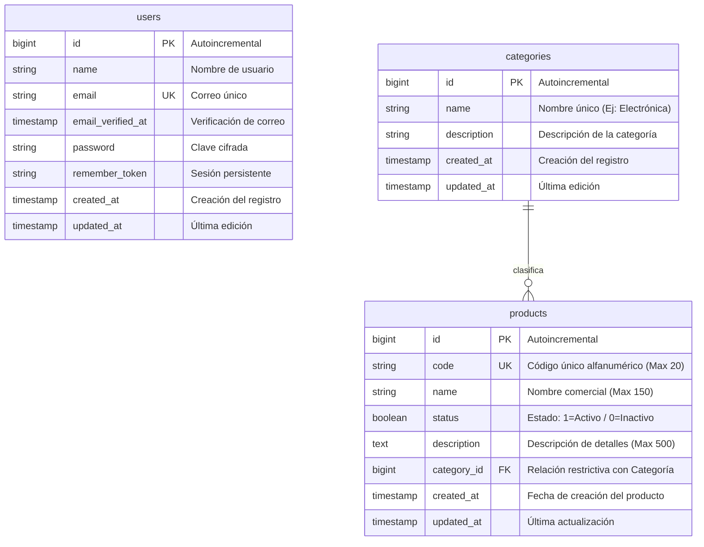
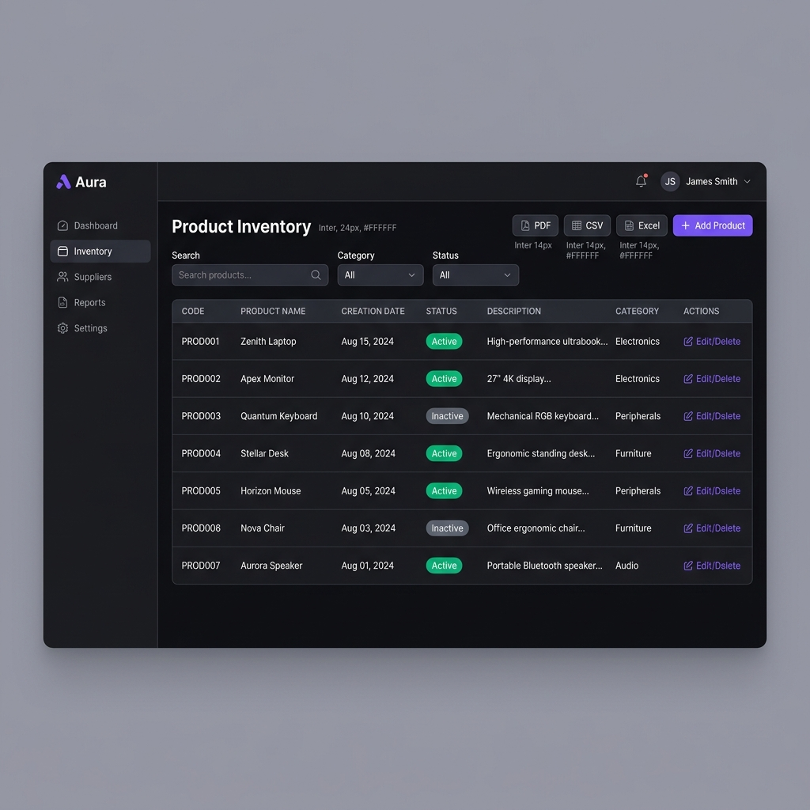
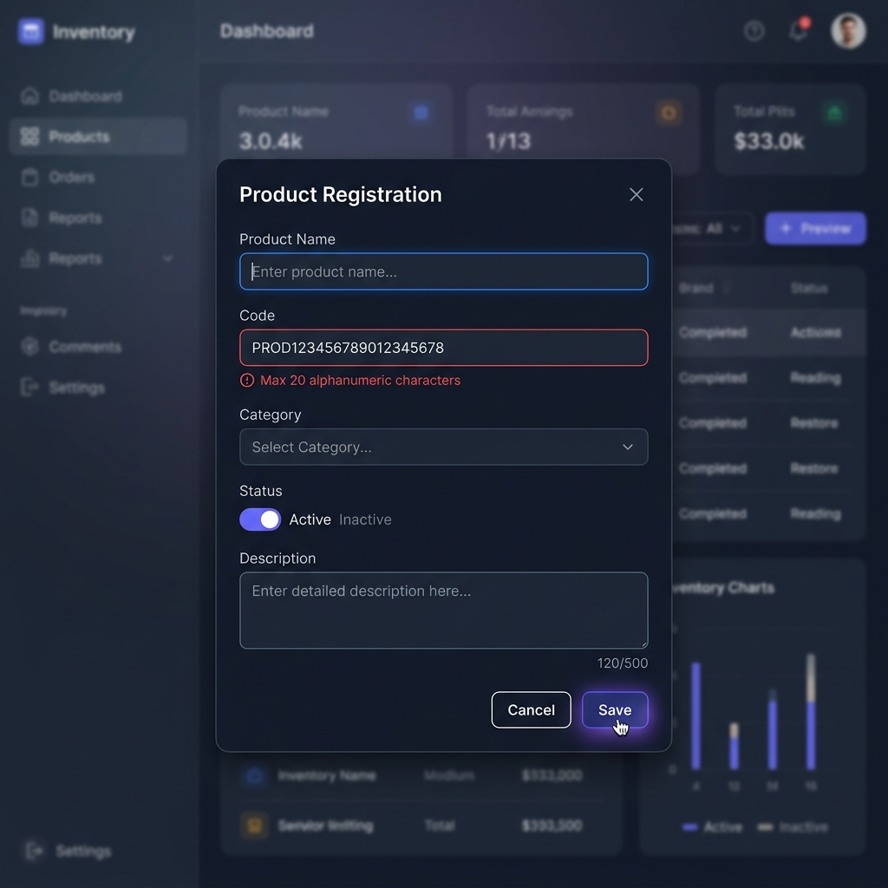

# Informe de Pruebas y Análisis Técnico
## Desarrollo y Pruebas del Módulo de Gestión de Inventarios

**Código del Examen:** PTAC002-0002  
**Versión:** 2  
**Vigencia:** 31-12-2024  
**Candidato:** Analista de Calidad de Software  

---

## 1. Documentación de Requisitos Funcionales (RF)

A continuación se detallan los requisitos funcionales identificados y analizados para el módulo de inventarios, utilizando un formato estándar de la industria.

| ID | Requisito Funcional | Descripción | Prioridad | Criterios de Aceptación |
| :--- | :--- | :--- | :--- | :--- |
| **RF-01** | Operaciones CRUD de Productos | El sistema debe permitir Crear, Leer, Actualizar y Eliminar (CRUD) productos en el inventario. | Alta | - El usuario autenticado puede ingresar nuevos productos.<br>- Los productos creados deben listarse en la tabla principal.<br>- Se puede editar cualquier producto existente.<br>- Se puede eliminar un producto con confirmación previa. |
| **RF-02** | Columnas de la Tabla Principal | La tabla principal debe mostrar obligatoriamente las columnas: Código, Nombre del producto, Fecha de creación, Estado (activo/inactivo) y Descripción. | Alta | - La tabla debe renderizarse con las 5 columnas requeridas.<br>- El código debe mostrarse en formato legible.<br>- La fecha de creación debe tener formato de fecha estándar (DD/MM/AAAA).<br>- El estado debe mostrarse con un indicador visual (badge/color). |
| **RF-03** | Exportación de Datos | Permitir la exportación del listado de productos filtrados a los formatos PDF, CSV y Excel. | Media-Alta | - El sistema debe proveer botones de exportación individuales en la UI.<br>- El archivo CSV debe usar delimitadores compatibles y codificación UTF-8.<br>- El archivo Excel (.xls/.xlsx) debe abrirse sin errores en MS Excel.<br>- El PDF debe contener una versión optimizada e imprimible de la tabla. |
| **RF-04** | Validaciones de Formulario | Restringir el ingreso de datos en el formulario según los límites definidos en la especificación técnica. | Alta | - **Código:** Máximo 20 caracteres alfanuméricos. Bloquear o mostrar error si se excede o si se usan caracteres especiales.<br>- **Nombre:** Máximo 150 caracteres.<br>- **Descripción:** Máximo 500 caracteres. |

---

## 2. Historias de Usuario (HU)

Se definen 3 historias de usuario críticas con sus correspondientes criterios de aceptación detallados bajo la sintaxis *Gherkin* (Dado / Cuando / Entonces).

### HU-01: Creación de Productos con Validación
**COMO** usuario del sistema de inventarios  
**QUIERO** registrar un nuevo producto en el formulario de la modal  
**PARA** mantener actualizado el stock de productos en el sistema  

*   **Criterio de Aceptación 1 (Validación de longitud):**
    *   **Dado** que el usuario abre la modal de registro de producto
    *   **Cuando** ingresa un código de más de 20 caracteres alfanuméricos, o un nombre de más de 150 caracteres, o una descripción de más de 500 caracteres
    *   **Entonces** el sistema debe mostrar un mensaje de error visual debajo del campo indicando el límite excedido y deshabilitar el botón de guardar.
*   **Criterio de Aceptación 2 (Validación de caracteres alfanuméricos en Código):**
    *   **Dado** que el usuario está llenando el campo de Código
    *   **Cuando** ingresa caracteres especiales (como `$-_*#`)
    *   **Entonces** el sistema debe mostrar un mensaje de error advirtiendo que solo se permiten letras y números.

---

### HU-02: Exportación del Inventario
**COMO** administrador de bodega  
**QUIERO** exportar los productos de la tabla a formato CSV, Excel y PDF  
**PARA** generar reportes rápidos para la gerencia y realizar auditorías físicas  

*   **Criterio de Aceptación 1 (Exportación a CSV/Excel):**
    *   **Dado** que el usuario tiene un listado de productos filtrados en la tabla principal
    *   **Cuando** hace clic en el botón "CSV" o "Excel"
    *   **Entonces** el navegador debe iniciar la descarga automática de un archivo con el formato seleccionado y que contenga exactamente los registros filtrados en pantalla.
*   **Criterio de Aceptación 2 (Exportación a PDF):**
    *   **Dado** que el usuario tiene el listado en la tabla
    *   **Cuando** hace clic en el botón "PDF"
    *   **Entonces** el sistema debe abrir una pestaña de reporte optimizada y gatillar la ventana nativa de impresión/guardado a PDF del navegador.

---

### HU-03: Actualización del Estado del Producto
**COMO** supervisor de inventarios  
**QUIERO** cambiar el estado de un producto (Activo/Inactivo)  
**PARA** dar de baja temporalmente productos descontinuados sin eliminarlos del historial  

*   **Criterio de Aceptación 1 (Cambio de estado exitoso):**
    *   **Dado** que el usuario abre el formulario de edición de un producto activo
    *   **Cuando** desmarca el switch de estado (poniéndolo en "Inactivo") y guarda el producto
    *   **Entonces** la tabla principal debe actualizar inmediatamente el indicador visual del producto a "Inactivo" en color gris y persistir este cambio en la base de datos.

---

## 3. Casos de Prueba basados en Caja Negra (Análisis de Valor Límite - BVA)

El Análisis de Valor Límite (BVA) se enfoca en probar los extremos de las clases de equivalencia admitidas por los campos del formulario.

### Campo: Código (Límite: Máximo 20 caracteres, Alfanumérico)
*Clases de Equivalencia:*
- Válida: Cadenas alfanuméricas de longitud entre 1 y 20.
- Inválida: Longitud 0 (vacío), longitud > 20, o inclusión de caracteres no alfanuméricos.

| ID Prueba | Campo | Valor de Entrada | Longitud | Resultado Esperado | Resultado Real | Estado |
| :--- | :--- | :--- | :---: | :--- | :--- | :--- |
| **TC-COD-01** | Código | *(Vacío)* | 0 | Error: "El código es obligatorio." | Igual al esperado | Exitoso |
| **TC-COD-02** | Código | `A` (Mínimo) | 1 | Guardado Exitoso | Igual al esperado | Exitoso |
| **TC-COD-03** | Código | `PROD1234567890123456` | 20 | Guardado Exitoso | Igual al esperado | Exitoso |
| **TC-COD-04** | Código | `PROD12345678901234567` | 21 | Error: "El código no puede superar los 20 caracteres." | Igual al esperado | Exitoso |
| **TC-COD-05** | Código | `PROD-001` | 8 | Error: "El código solo puede contener letras y números." | Igual al esperado | Exitoso |

### Campo: Nombre (Límite: Máximo 150 caracteres, Texto libre)
*Clases de Equivalencia:*
- Válida: Longitud entre 1 y 150.
- Inválida: Longitud 0 (vacío), longitud > 150.

| ID Prueba | Campo | Valor de Entrada | Longitud | Resultado Esperado | Resultado Real | Estado |
| :--- | :--- | :--- | :---: | :--- | :--- | :--- |
| **TC-NOM-01** | Nombre | *(Vacío)* | 0 | Error: "El nombre es obligatorio." | Igual al esperado | Exitoso |
| **TC-NOM-02** | Nombre | `X` (Mínimo) | 1 | Guardado Exitoso | Igual al esperado | Exitoso |
| **TC-NOM-03** | Nombre | *(Cadena de 'A's)* | 150 | Guardado Exitoso (Límite exacto) | Igual al esperado | Exitoso |
| **TC-NOM-04** | Nombre | *(Cadena de 'A's)* | 151 | Error: "El nombre no puede superar los 150 caracteres." | Igual al esperado | Exitoso |

### Campo: Descripción (Límite: Máximo 500 caracteres, Texto libre)
*Clases de Equivalencia:*
- Válida: Longitud entre 1 y 500.
- Inválida: Longitud 0 (vacío), longitud > 500.

| ID Prueba | Campo | Valor de Entrada | Longitud | Resultado Esperado | Resultado Real | Estado |
| :--- | :--- | :--- | :---: | :--- | :--- | :--- |
| **TC-DES-01** | Descripción| *(Vacío)* | 0 | Error: "La descripción es obligatoria." | Igual al esperado | Exitoso |
| **TC-DES-02** | Descripción| `D` (Mínimo) | 1 | Guardado Exitoso | Igual al esperado | Exitoso |
| **TC-DES-03** | Descripción| *(Cadena de 'D's)* | 500 | Guardado Exitoso (Límite exacto) | Igual al esperado | Exitoso |
| **TC-DES-04** | Descripción| *(Cadena de 'D's)* | 501 | Error: "La descripción no puede superar los 500 caracteres." | Igual al esperado | Exitoso |

---

## 4. Diagrama Entidad-Relación (E-R)

El siguiente modelo de datos en formato Mermaid representa la arquitectura física y lógica del módulo de inventarios, mostrando su relación con la tabla de **Categorías** (Auxiliar) y **Usuarios** (Auditoría/Creador).



---

## 5. Diseños Visuales y Mockups Premium

Se diseñaron dos mockups con una estética premium en modo oscuro, alineándose a las tendencias de diseño actuales (estilo Glassmorphism con acentos violeta/neón).

### Vista A: Tabla Principal de Inventarios
Esta vista muestra la lista estructurada de productos, barra de herramientas con búsqueda dinámica, filtrado por categorías/estados y botones para exportar.



---

### Vista B: Modal de Creación / Edición
Formulario interactivo en superposición (overlay) con desenfoque de fondo. Incorpora el control de switch de estado y advertencias de validación visuales.



---

## 6. Automatización de Pruebas (Bonus)

Se desarrolló un script de automatización completo y autónomo utilizando **Cypress** para validar el flujo crítico de Login.

*   **Ambiente de Prueba:** [qa.nuevoerp.co](https://qa.nuevoerp.co)
*   **Credencial de Usuario:** `pruebas.aleerp2023@sinergiaonline.com`
*   **Contraseña:** `Sinergia_2023-`

### Ruta del Código Fuente del Script
El código está guardado en el archivo:
[cypress/e2e/login.cy.js](file:///c:/dev/inventario-prueba/cypress/e2e/login.cy.js)

### Instrucciones de Ejecución
Para correr el script en tu máquina local, sigue estos pasos:

1.  **Instalar dependencias del proyecto y Cypress (si no están instaladas):**
    ```bash
    npm install cypress --save-dev
    ```
2.  **Abrir la interfaz interactiva de Cypress:**
    ```bash
    npx cypress open
    ```
    Selecciona **E2E Testing**, escoge tu navegador preferido y ejecuta el archivo de prueba `login.cy.js`.
3.  **Ejecutar pruebas en modo headless (consola):**
    ```bash
    npx cypress run --spec "cypress/e2e/login.cy.js"
    ```
